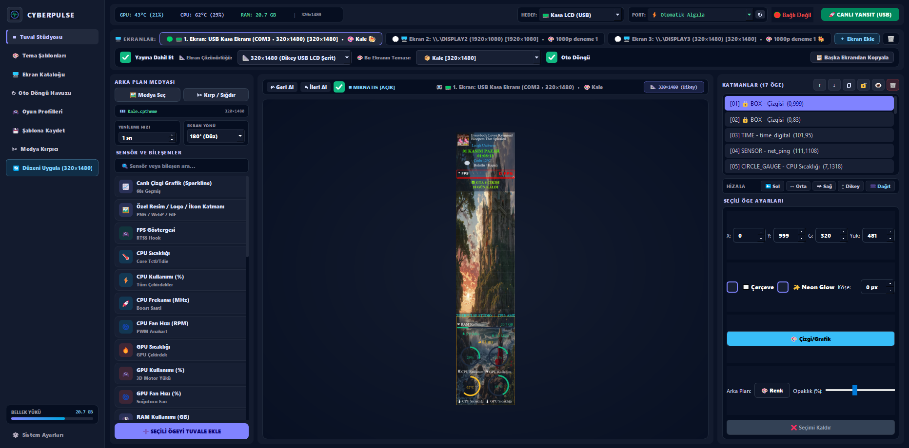

<div align="center">

# ⚡ CYBERPULSE — PC Kasa Ekranı & Tema Stüdyosu

**USB Seri (320×1480 / Turing / XuanFang / HYTE / Lian Li / Corsair) ve HDMI/DP kasa içi IPS ekranlar için gerçek zamanlı donanım telemetrisi, çoklu ekran stüdyosu ve otomatik oyun profili yöneticisi.**

[](#)
[](#)
[](LICENSE)

<br/>

<!-- ☕ BANA BİR KAHVE ISMARLA / BAĞIŞ BUTONU -->
<!-- Buy Me a Coffee hesabınızdaki kullanıcı adınız farklıysa 'blackxtr' kısmını güncelleyebilirsiniz -->
<a href="https://www.buymeacoffee.com/blackxtr" target="_blank">
  
</a>

</div>

---

## 🖥️ Arayüz Önizlemesi

<div align="center">
  
</div>

---

## ✨ Öne Çıkan Özellikler

- **🖥️ Çoklu Ekran Çalışma Alanı (Multi-Screen Workspace):**
  - Aynı anda hem **USB Seri LCD (COM Port)** hem de **HDMI / DisplayPort** kasa ekranlarını bağımsız temalarla ve bağımsız çözünürlüklerle (`320×1480`, `480×1920`, `1280×400`, `1920×1080`, `2560×1440`, `3840×2160` veya özel boyut) yönetin.
- **📊 30+ Canlı Donanım ve Medya Bileşeni:**
  - **CPU & GPU:** Sıcaklık, yük (%), frekans (MHz), fan devri (RPM/%).
  - **Sistem & Ağ:** RAM kullanımı, NVMe/SATA disk okuma-yazma hızı, canlı indirme/yükleme (Download/Upload) hızı, canlı Ping monitörü ve 60 saniyelik Sparkline çizgi grafikleri.
  - **Zengin Widget'lar:** RTSS/Win32 tabanlı oyun FPS sayacı, Windows SMTC canlı medya/YouTube Music kartı, otomatik konumlu hava durumu kartı, etkinlik geri sayım sayacı, dairesel/yatay/dikey göstergeler ve özelleştirilebilir kayan LED metin (Marquee).
- **🎮 Otomatik Oyun Profili Bağlayıcı:**
  - Bilgisayarınızdaki Steam, Epic Games veya özel `.exe` oyunlarını istediğiniz temaya bağlayın. Oyun açıldığında kasa ekranınız otomatik olarak o oyunun temasına geçer, oyun kapandığında masaüstü temanıza geri döner.
- **↻ Seçmeli Otomatik Tema Döngüsü (Playlist):**
  - Her ekran için ayrı ayrı hangi temaların, hangi süreyle ve sırayla (veya rastgele) değişeceğini belirleyin.
- **📦 Tek Dosya `.cptheme` Paketleme & Akıllı Ölçeklendirme:**
  - Arka plan videoları (`.mp4`, `.gif`, `.png`), özel katman görselleri ve tüm sensör yerleşimleri tek bir taşınabilir `.cptheme` dosyasında saklanır.
  - Farklı çözünürlükteki bir ekrana geçildiğinde veya **"Düzeni Uygula"** kullanıldığında tüm bileşenler orantısal olarak hedef çözünürlüğe uyarlanır.

---

## 🚀 Kurulum ve Çalıştırma

### 1. Gereksinimleri Yükleyin
```bash
git clone https://github.com/blackxtr-lang/cyberpulse-lcd-studio.git
cd cyberpulse-lcd-studio
pip install -r requirements.txt
```

### 2. Uygulamayı Başlatın
```bash
python cyberpulse_studio/main_gui.py
```
*(Windows'ta doğrudan `cyberpulse_studio/CYBERPULSE_Studio.bat` dosyasına çift tıklayarak da başlatabilirsiniz.)*

---

## ☕ Projeyi Destekleyin (Bana Bir Kahve Ismarla)

**CyberPulse Studio** tamamen açık kaynaklı ve ücretsiz olarak geliştirilmektedir. Projeyi beğendiyseniz ve yeni ekran protokolleri / bileşenler eklenmesine destek olmak isterseniz bir kahve ısmarlayabilirsiniz:

<div align="center">

<!-- Buy Me a Coffee hesabınızdaki kullanıcı adınız farklıysa 'blackxtr' kısmını güncelleyebilirsiniz -->
<a href="https://www.buymeacoffee.com/blackxtr" target="_blank">
  
</a>

</div>

---

## 📄 Lisans

Bu proje [MIT Lisansı](LICENSE) altında lisanslanmıştır.
