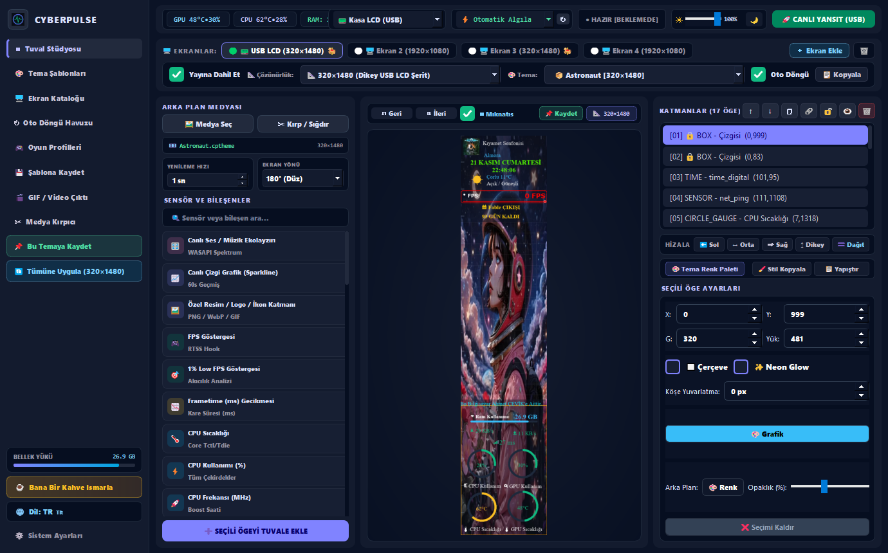
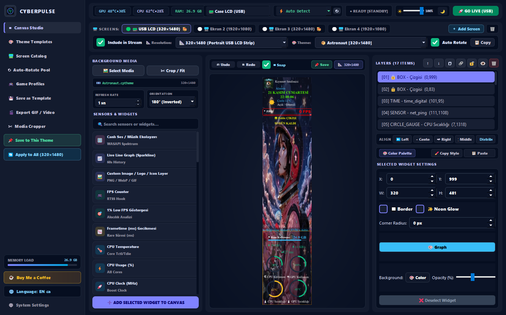

<div align="center">

# ⚡ CYBERPULSE — PC Kasa Ekranı & Tema Stüdyosu / PC Case Screen & Theme Studio

**🇹🇷 USB Seri (`320×1480` / Turing / XuanFang / HYTE / Lian Li / Corsair) ve HDMI/DP kasa içi IPS ekranlar için gerçek zamanlı donanım telemetrisi, çoklu ekran stüdyosu ve otomatik oyun profili yöneticisi.**

**🇬🇧 Real-time hardware telemetry, multi-display theme studio, and automatic game profile switcher for USB Serial (`320×1480` / Turing / XuanFang / HYTE / Lian Li / Corsair) and HDMI/DP in-case IPS displays.**

<br/>

<!-- 🌐 SAYFA İÇİ DİL GEÇİŞİ / IN-PAGE LANGUAGE JUMP LINKS -->
[](#-türkçe-tanıtım-ve-kullanım-rehberi)
[](#-english-overview--documentation)

[-00a6e0?style=flat-square&logo=windows&logoColor=white)](#)
[](#)
[-ef4444?style=flat-square)](LICENSE)

<br/>

<!-- 📥 DOĞRUDAN .EXE İNDİRME & ☕ BAĞIŞ BUTONLARI / DIRECT .EXE DOWNLOAD & DONATION -->
<a href="https://github.com/blackxtr-lang/cyberpulse-lcd-studio/releases/latest/download/CyberPulse_Studio_Windows_x64.zip">
  
</a>
&nbsp;&nbsp;
<a href="https://github.com/sponsors/blackxtr-lang" target="_blank">
  
</a>

</div>

---

# 🇹🇷 Türkçe Tanıtım ve Kullanım Rehberi

## 🖥️ Arayüz Önizlemesi (Türkçe Modu)

<div align="center">
  
</div>

## 📥 Kurulumsuz İndirme ve Kullanım (`.exe`)

Python veya ek kütüphane kurmanıza gerek yoktur:

1. Yukarıdaki **[📥 İndir / Download (.EXE) — Windows Portable ZIP](https://github.com/blackxtr-lang/cyberpulse-lcd-studio/releases/latest/download/CyberPulse_Studio_Windows_x64.zip)** butonuna (veya sağ taraftaki **[Releases](https://github.com/blackxtr-lang/cyberpulse-lcd-studio/releases)** bölümüne) tıklayarak `CyberPulse_Studio_Windows_x64.zip` dosyasını indirin.
2. ZIP arşivini bilgisayarınızda istediğiniz bir klasöre çıkartın.
3. Klasör içindeki **`CyberPulse_Studio.exe`** dosyasına çift tıklayarak programı doğrudan başlatın!
4. Sol menünün altındaki **`🌐 Dil: TR 🇹🇷 / EN 🇬🇧`** butonuna tıklayarak uygulama dilini istediğiniz an **Türkçe** veya **İngilizce** yapabilirsiniz.

## ✨ Öne Çıkan Özellikler

- **🌐 Çift Dilli Arayüz (`🇹🇷 Türkçe` / `🇬🇧 English`):**
  - Sol menüdeki tek tuşla veya Sistem Ayarları üzerinden tüm stüdyo ve alt pencereleri anında Türkçe / İngilizce arasında değiştirin.
- **🖥️ Çoklu Ekran Çalışma Alanı (Multi-Screen Workspace):**
  - Aynı anda hem **USB Seri LCD (COM Port)** hem de **HDMI / DisplayPort** kasa ekranlarını bağımsız temalarla ve bağımsız çözünürlüklerle (`320×1480`, `480×1920`, `1280×400`, `1920×1080`, `2560×1440`, `3840×2160` veya özel boyut) yönetin.
- **📊 40+ Canlı Donanım, Ses ve Medya Bileşeni:**
  - **CPU, GPU, Güç & Soğutma:** CPU/GPU sıcaklığı, GPU Hotspot sıcaklığı, CPU/GPU yükü (%), frekans (MHz), **CPU Paket Gücü (W)**, **GPU Güç Tüketimi (W)**, **Sıvı Soğutma (AIO) Sıcaklığı (°C)**, **Anakart / VRM Sıcaklığı (°C)** ve fan devri (RPM/%).
  - **Oyun Performans Analizi:** RTSS/Win32 tabanlı canlı **FPS Sayacı**, **🎯 1% Low FPS**, **📉 Frametime (`ms`)** gecikmesi, **🕹️ Aktif Oyun Oturum Süresi** ve **⏳ PC Açık Kalma Süresi (Uptime)** sayaçları.
  - **🎛️ Canlı Ses / Müzik Ekolayzırı (WASAPI Audio Visualizer):** Sistem sesine duyarlı gerçek zamanlı 24-bant **Dikey LED Barlar (Bars)** ve **Akıcı Neon Ses Dalgası (Wave)** spektrumu.
  - **Sistem Belleği, GPU VRAM & Ağ (6 Farklı Gösterim Modu):** Hem Sistem RAM hem de GPU VRAM için 6 seçilebilir mod (`Kullanılan GB`, `Kullanılan %`, `Kullanılan GB + %`, `Kalan/Boş GB`, `Kalan %`, `Kalan GB + %` — gösterilen değer ile ilerleme çubuğu her zaman birebir senkronize!), NVMe/SATA disk I/O hızı, canlı Download/Upload hızı, canlı Ping monitörü ve 60 saniyelik Sparkline çizgi grafikleri.
- **📌 Tema Bazlı Bağımsız Düzen Kaydetme & Seçmeli Düzen Aktarımı:**
  - **`📌 Bu Temaya Kaydet` (`Ctrl+S`):** Araç yerleşimini yalnızca aktif temaya kaydederek her temanın kendine özgü farklı bir düzene sahip olmasını sağlar.
  - **`🔄 Tümüne Uygula` (Çoklu Seçim Penceresi):** Mevcut düzeni aynı çözünürlükteki tüm temalara veya onay kutularıyla seçtiğiniz belirli temalara tek tıkla aktarır.
- **🎨 Tek Tıkla Tema Renk Paleti, 🖌️ Stil Kopyala/Yapıştır & 🔗 Katman Gruplama:**
  - Tek tıkla tüm araçları 6 hazır renk paletine (*Siber Mavi, ROG Kırmızı, Matrix Yeşil, Neon Synthwave Mor, Cyberpunk Altın, Buz Beyazı*) dönüştürün, araç stillerini kopyalayıp yapıştırın (`Ctrl+Shift+C` / `Ctrl+Shift+V`), öğeleri gruplayın (`Ctrl+G`) ve piksel cetvelleriyle hizalayın.
- **☀️ Ekran Parlaklığı, 🌙 Uyku Modu, Windows Kilidi (`Win+L`) IPS Koruması & 🎬 GIF/MP4 Çıktı:**
  - Üst çubuktan ekran parlaklığını (`%5-%100`) ayarlayın, bilgisayar kilitlendiğinde (`Win+L`) kasa ekranını otomatik uyku moduna alın ve aktif temanızı hareketli **`.gif` veya `.mp4` video** olarak dışa aktarın.
- **🎮 14+ Oyun Başlatıcısı (Launcher) Destekli Otomatik Oyun Profili Bağlayıcı:**
  - **Steam, Epic Games, Xbox / PC Game Pass (`.GamingRoot`), Riot Games, EA App / Origin, Ubisoft Connect, Battle.net, GOG Galaxy, Rockstar Games, Amazon Games, Heroic, itch.io, HoYoPlay, Wargaming** ve özel oyun klasörlerindeki oyunları otomatik bulur; oyun açıldığında o oyunun temasına geçer, kapandığında masaüstü temanıza döner.
- **↻ Seçmeli Otomatik Tema Döngüsü (Playlist):**
  - Her ekran için ayrı ayrı hangi temaların, hangi süreyle ve sırayla (veya rastgele) değişeceğini belirleyin.
- **📦 Tek Dosya `.cptheme` Paketleme & Akıllı Ölçeklendirme:**
  - Arka plan videoları (`.mp4`, `.gif`, `.png`), özel katman görselleri ve tüm sensör yerleşimleri tek bir taşınabilir `.cptheme` dosyasında saklanır.
  - Farklı çözünürlükteki bir ekrana geçildiğinde veya **"Düzeni Uygula"** kullanıldığında tüm bileşenler orantısal olarak hedef çözünürlüğe uyarlanır.

---

# 🇬🇧 English Overview & Documentation

## 🖥️ Studio Preview (English Mode)

<div align="center">
  
</div>

## 📥 Portable Download & Quick Start (`.exe`)

No Python installation is required to run the standalone Windows build:

1. Click **[📥 İndir / Download (.EXE) — Windows Portable ZIP](https://github.com/blackxtr-lang/cyberpulse-lcd-studio/releases/latest/download/CyberPulse_Studio_Windows_x64.zip)** at the top of this page (or visit the **[Releases](https://github.com/blackxtr-lang/cyberpulse-lcd-studio/releases)** section on the right).
2. Extract `CyberPulse_Studio_Windows_x64.zip` to any folder on your PC.
3. Double-click **`CyberPulse_Studio.exe`** to launch!
4. Click **`🌐 Language: EN 🇬🇧 / TR 🇹🇷`** at the bottom of the left sidebar to switch between **English** and **Turkish** anytime.

## ✨ Key Features

- **🌐 Bilingual Studio Interface (`🇬🇧 English` / `🇹🇷 Türkçe`):**
  - Switch the entire studio and all sub-dialogs between English and Turkish with a single click from the left sidebar or System Settings.
- **🖥️ Multi-Screen Workspace Engine:**
  - Drive both **USB Serial LCDs (COM Port)** and **HDMI / DisplayPort** case monitors simultaneously with independent themes and independent resolutions (`320×1480`, `480×1920`, `1280×400`, `1920×1080`, `2560×1440`, `3840×2160`, or custom dimensions).
- **📊 40+ Live Hardware, Audio & Media Widgets:**
  - **CPU, GPU, Power & Cooling:** CPU/GPU temperature, GPU Hotspot temperature, CPU/GPU load (%), clock frequency (MHz), **CPU Package Power (W)**, **GPU Power Draw (W)**, **Liquid Cooler (AIO) Temp (°C)**, **Motherboard / VRM Temp (°C)**, and fan speeds (RPM/%).
  - **Game Performance Telemetry:** RTSS/Win32 in-game **FPS Counter**, **🎯 1% Low FPS**, **📉 Frametime (`ms`)** latency, **🕹️ Active Game Session Timer**, and **⏳ System Uptime** counters.
  - **🎛️ Live WASAPI Audio Visualizer:** Real-time 24-band reactive **Vertical LED Bars** and **Smooth Dual Neon Waveform** spectrum widgets.
  - **System RAM, GPU VRAM & Network (6 Display Modes):** Both System RAM and GPU VRAM support 6 user-selectable modes (`Used GB`, `Used %`, `Used GB + %`, `Free GB`, `Free %`, `Free GB + %` — the progress bar always matches the displayed metric!), NVMe/SATA disk I/O, live Download/Upload speed, Ping monitor, and 60s Sparkline graphs.
- **📌 Per-Theme Independent Layout Saving & Selective Multi-Theme Sync:**
  - **`📌 Save to This Theme` (`Ctrl+S`):** Saves widget layout only to the currently active theme so every theme maintains its own independent layout.
  - **`🔄 Apply to All` (Multi-Select Checklist):** Copy the active layout across all or specific checked themes of the same resolution in one click.
- **🎨 1-Click Theme Color Palettes, 🖌️ Style Copy/Paste & 🔗 Layer Grouping:**
  - Transform all widgets into 6 cohesive color palettes (*Cyber Cyan, ROG Red, Matrix Green, Neon Synthwave Purple, Cyberpunk Gold, Ice White*), copy/paste visual styles across widgets (`Ctrl+Shift+C` / `Ctrl+Shift+V`), group elements (`Ctrl+G`), and align with canvas pixel rulers.
- **☀️ Display Brightness, 🌙 Standby Mode, Windows Lock (`Win+L`) IPS Protection & 🎬 GIF/MP4 Export:**
  - Adjust hardware/frame brightness (`5%–100%`) from the top bar, automatically put the case screen to sleep when Windows is locked (`Win+L`), and export live animated **`.gif` or `.mp4` video** previews of your active theme.
- **🎮 14+ Game Launcher Auto-Discovery & Game Profile Switcher:**
  - Automatically scans **Steam, Epic Games, Xbox / PC Game Pass (`.GamingRoot`), Riot Games, EA App / Origin, Ubisoft Connect, Battle.net, GOG Galaxy, Rockstar Games, Amazon Games, Heroic, itch.io, HoYoPlay, Wargaming**, and custom game folders; switches to a game's bound theme on launch and restores your desktop theme on exit.
- **↻ Per-Screen Selective Auto-Rotation (Playlist):**
  - Choose which themes rotate, in what order (sequential or shuffle), and at what interval independently for each connected display.
- **📦 Single-File `.cptheme` Packaging & Smart Resolution Scaling:**
  - Background videos (`.mp4`, `.gif`, `.png`), custom overlay graphics, and widget layouts are packed into a single portable `.cptheme` file with automatic aspect-ratio scaling across different display resolutions.

---

## 🛠️ Kaynak Koddan Çalıştırma / Running from Source (Developers)

```bash
git clone https://github.com/blackxtr-lang/cyberpulse-lcd-studio.git
cd cyberpulse-lcd-studio
pip install -r requirements.txt
python cyberpulse_studio/main_gui.py
```
- **🇹🇷 Yerel `.exe` Derleme:** Klasördeki `build_exe.bat` dosyasına çift tıklayarak kendi taşınabilir `.exe` paketinizi oluşturabilirsiniz.
- **🇬🇧 Local `.exe` Build:** Double-click `build_exe.bat` to compile your own standalone portable `.exe` bundle in `dist/CyberPulse_Studio/`.

---

## ☕ Projeyi Destekleyin / Support the Project (Buy Me a Coffee)

- **🇹🇷 Türkçe:** **CyberPulse Studio** tamamen açık kaynaklı ve ücretsiz olarak geliştirilmektedir. Projeyi beğendiyseniz ve yeni ekran protokolleri / bileşenler eklenmesine destek olmak isterseniz bir kahve ısmarlayabilirsiniz.
- **🇬🇧 English:** **CyberPulse Studio** is completely free and open-source. If you enjoy using it and want to support the addition of new display protocols and widgets, consider buying me a coffee:

<div align="center">

<a href="https://github.com/sponsors/blackxtr-lang" target="_blank">
  
</a>

</div>

---

## 📄 Lisans / License (CC BY-NC-SA 4.0 — Ticari Kullanım Yasaktır / Non-Commercial Only)

- **🇹🇷 Türkçe:** Bu proje **[Creative Commons Atıf-GayriTicari-AynıLisanslaPaylaş 4.0 Uluslararası (CC BY-NC-SA 4.0)](LICENSE)** lisansı altında lisanslanmıştır. **Hiçbir ticari kullanıma izin verilmez** (yazılımın veya türevlerinin para karşılığı satılması, ücretli donanım/ekran paketleriyle ticari olarak dağıtılması veya ticari bir ürün/hizmetin parçası yapılması kesinlikle yasaktır). Değiştirilen veya geliştirilen türev çalışmalar da kaynak belirtilerek aynı ticari olmayan lisansla (`CC BY-NC-SA 4.0`) paylaşılmak zorundadır.
- **🇬🇧 English:** This project is licensed under the **[Creative Commons Attribution-NonCommercial-ShareAlike 4.0 International (CC BY-NC-SA 4.0)](LICENSE)** license. **Commercial use of any kind is strictly prohibited** (selling the software or derivatives, bundling it commercially with hardware/LCD displays, or using it in commercial products/services is forbidden). Any modifications or derivative works must give appropriate credit and be distributed under the same non-commercial license (`CC BY-NC-SA 4.0`).
