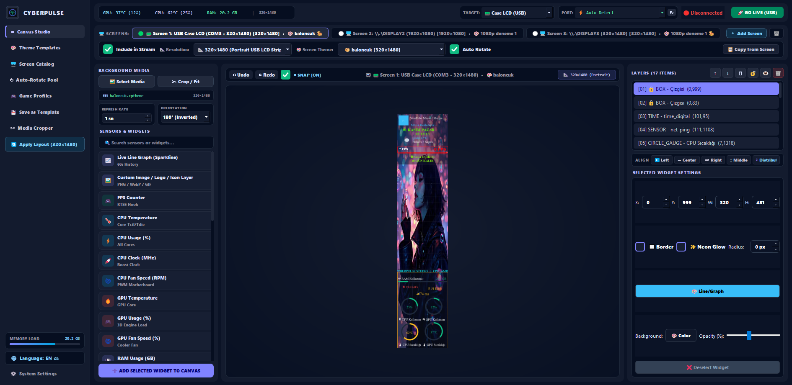

<div align="center">

# ⚡ CYBERPULSE — PC Case Screen & Theme Studio

<!-- 🌐 LANGUAGE SWITCHER -->
[-222a3d?style=for-the-badge)](README.md)
[-00a6e0?style=for-the-badge)](README_EN.md)

**Real-time hardware telemetry, multi-display theme studio, and automatic game profile switcher for USB Serial (`320×1480` / Turing / XuanFang / HYTE / Lian Li / Corsair) and HDMI/DP in-case IPS displays.**

[-00a6e0?style=flat-square&logo=windows&logoColor=white)](#)
[](#)
[](LICENSE)

<br/>

<!-- 📥 DIRECT .EXE DOWNLOAD & ☕ DONATION BUTTONS -->
<a href="https://github.com/blackxtr-lang/cyberpulse-lcd-studio/releases/latest/download/CyberPulse_Studio_Windows_x64.zip">
  
</a>
&nbsp;&nbsp;
<a href="https://www.buymeacoffee.com/blackxtr" target="_blank">
  
</a>

</div>

---

## 🖥️ Studio Preview (`🇬🇧 English` & `🇹🇷 Türkçe` Bilingual UI)

<div align="center">
  
</div>

---

## 📥 Portable Download & Quick Start (`.exe`)

No Python installation is required to run the standalone Windows build:

1. Click **[📥 Download for Windows (Portable .EXE ZIP)](https://github.com/blackxtr-lang/cyberpulse-lcd-studio/releases/latest/download/CyberPulse_Studio_Windows_x64.zip)** above (or visit the **[Releases](https://github.com/blackxtr-lang/cyberpulse-lcd-studio/releases)** tab on the right).
2. Extract `CyberPulse_Studio_Windows_x64.zip` to any folder on your PC.
3. Double-click **`CyberPulse_Studio.exe`** to launch!
4. Click **`🌐 Language: EN / TR`** at the bottom of the left sidebar to switch between **English** and **Turkish** anytime.

---

## ✨ Key Features

- **🌐 Bilingual Studio Interface (`🇬🇧 English` / `🇹🇷 Türkçe`):**
  - Switch the entire studio and all sub-dialogs between English and Turkish with a single click from the left sidebar or System Settings.
- **🖥️ Multi-Screen Workspace Engine:**
  - Drive both **USB Serial LCDs (COM Port)** and **HDMI / DisplayPort** case monitors simultaneously with independent themes and independent resolutions (`320×1480`, `480×1920`, `1280×400`, `1920×1080`, `2560×1440`, `3840×2160`, or custom dimensions).
- **📊 30+ Live Hardware & Media Widgets:**
  - **CPU & GPU:** Temperature, load (%), clock frequency (MHz), fan speed (RPM/%).
  - **System & Network:** RAM usage, NVMe/SATA disk read/write throughput, live download/upload speed, live Ping monitor, and 60-second Sparkline history graphs.
  - **Rich Widgets:** RTSS/Win32 in-game FPS counter, Windows SMTC Now Playing / YouTube Music card, auto-location live weather card, event countdown timer, radial/horizontal/vertical gauges, and customizable scrolling LED ticker (Marquee).
- **🎮 Automatic Game Profile Switcher:**
  - Bind any installed Steam, Epic Games, or custom `.exe` game to a specific theme. When the game launches, your case screen automatically switches to that game's theme and restores your desktop theme when the game exits.
- **↻ Per-Screen Selective Auto-Rotation (Playlist):**
  - Choose which themes rotate, in what order (sequential or shuffle), and at what interval independently for each connected display.
- **📦 Single-File `.cptheme` Packaging & Smart Resolution Scaling:**
  - Background videos (`.mp4`, `.gif`, `.png`), custom overlay graphics, and widget layouts are packed into a single portable `.cptheme` file with automatic aspect-ratio scaling across different display resolutions.

---

## 🛠️ Running or Building from Source (For Developers)

```bash
git clone https://github.com/blackxtr-lang/cyberpulse-lcd-studio.git
cd cyberpulse-lcd-studio
pip install -r requirements.txt
python cyberpulse_studio/main_gui.py
```
*To build your own standalone `.exe` locally, simply run `build_exe.bat`.*

---

## ☕ Support the Project (Buy Me a Coffee)

**CyberPulse Studio** is completely free and open-source. If you enjoy using it and want to support the addition of new display protocols and widgets, consider buying me a coffee:

<div align="center">

<a href="https://www.buymeacoffee.com/blackxtr" target="_blank">
  
</a>

</div>

---

## 📄 License

Licensed under the [MIT License](LICENSE).
